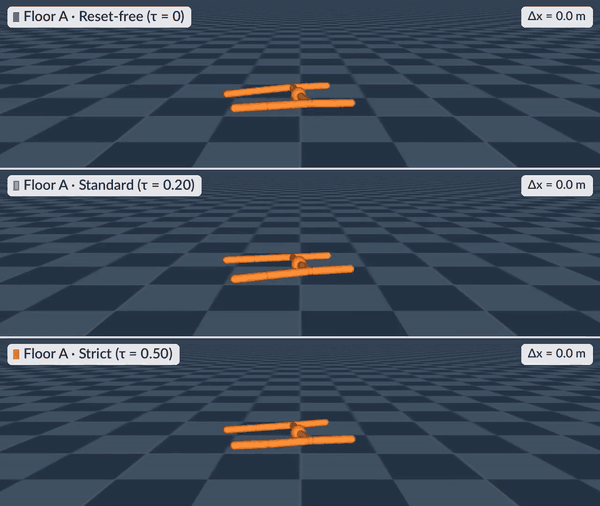

# Reset Dependence Is Embodied: Training Protocol Changes Which Morphologies Appear Optimal

[](https://reset-dependence.github.io/paper.pdf)
[](https://openreview.net/forum?id=w3aoxSAAcH)
[](https://reset-dependence.github.io/)
[](https://github.com/kevinxqiu/reset-dependence/releases/tag/v1.1.2)
[](LICENSE)
[](dataset/README.md)
[](requirements-analysis.txt)
[](https://openreview.net/forum?id=w3aoxSAAcH)

Kevin Qiu<sup>1</sup>, Zhao Yang<sup>2</sup>, Marek Cygan<sup>1</sup><br>
<sup>1</sup>University of Warsaw, <sup>2</sup>Vrije Universiteit Amsterdam<br>
NeurIPS 2026, Evaluations & Datasets Track

**Reset Dependence Is Embodied** shows that the reset rule used to train
controllers, the height at which a falling robot's episode ends, can change
which bodies a robot co-design benchmark ranks best. We train PPO controllers
for the 100 UNIMAL bodies of MetaMorph's benchmark under three rules
(Reset-free, τ = 0; Standard, τ = 0.20; Strict, τ = 0.50), three seeds each,
and score all 900 controllers with the same evaluator.

<p align="center">
  
</p>
<p align="center"><i>The same body after training under each reset rule (illustrative retrains): it barely moves forward under Reset-free, walks under Standard, and its Strict episode ends at step 9.</i></p>

## Highlights

- **The reset rule reorders the bodies.** After Strict and Reset-free
  training, the rankings of all 100 bodies correlate at Spearman ρ = 0.21,
  against about 0.89 if seed noise were the only difference.
- **Reset dependence is embodied.** Without fall resets, bodies evolved on
  flat ground lose 45% of their per-step reward relative to Standard
  training, and bodies evolved on variable terrain 16%.
- **Selecting for robustness costs little.** Bodies chosen by their worst
  reward across the three rules keep at least 91% of each rule's best reward
  in sample.

This repository holds the training code, the analysis code and the run
records. From the released run summaries, one seeded CPU script recomputes
2,401 values, among them nearly every statistic that the paper reports for the
UNIMAL bodies, in a few minutes and without any GPU training.

## Contents

- [Installation](#installation)
- [Recompute the paper's numbers](#recompute-the-papers-numbers)
- [Reproduce the figures and analyses](#reproduce-the-figures-and-analyses)
- [Run records](#run-records)
- [Training](#training)
- [Repository structure](#repository-structure)
- [Citation](#citation)

## Installation

The analysis code runs on a CPU with Python 3.10 to 3.14.

```bash
git clone https://github.com/kevinxqiu/reset-dependence
cd reset-dependence
python3 -m venv .venv && . .venv/bin/activate
pip install -r requirements-analysis.txt
```

Download the run records from
[release v1.1.2](https://github.com/kevinxqiu/reset-dependence/releases/tag/v1.1.2),
check and unzip them at the repository root, and fetch the 100 UNIMAL body
files. The body files are not redistributed, because their upstream
repositories declare no license; the script downloads them from the MetaMorph
release and checks each file against `assets/unimals_100/SHA256SUMS`.

```bash
gh release download v1.1.2 -R kevinxqiu/reset-dependence \
    -p runs.zip -p logs.zip -p panels.zip -p SHA256SUMS
sha256sum -c SHA256SUMS
unzip -q runs.zip && unzip -q logs.zip && unzip -q panels.zip
python scripts/fetch_unimal_assets.py   # 100 body files, hash-checked
```

Without the GitHub CLI, download the four files from the release page.

## Recompute the paper's numbers

```bash
python scripts/camera_ready_numbers.py --out-json numbers.json --out-md numbers.md
python scripts/check_numbers.py numbers.json
# 2401 values compared: 2401 match, 0 differ; ...
```

The first command takes about 5 minutes on a laptop CPU. It recomputes 2,401
values from the run summaries, the kept training logs, the panels in
other design spaces and a MuJoCo re-run of the zero-action rollouts. Its bootstraps and
permutation tests are seeded, so `check_numbers.py` finds every value equal to
the recorded
[`records/camera_ready_numbers.json`](records/camera_ready_numbers.json) up to
floating-point rounding. [`records/camera_ready_numbers.md`](records/camera_ready_numbers.md)
lists each value with its definition and body set, and names the printed
numbers that the script does not recompute. The main results are stored under
these keys:

| Result | Paper | Value | Key |
| --- | --- | --- | --- |
| Spearman ρ between the rankings after Reset-free and Strict training | Table 2 | 0.21 [−0.02, 0.40] | `rank.rho3.rf_str.all100` |
| The same ρ if seed noise were the only difference | Table 2 | 0.89 [0.84, 0.92] | `rank.noise_ref.rf_str.all100` |
| Per-step reward kept after Reset-free training, relative to Standard, Floor and VT | Table 1 | 0.55 and 0.84 | `fam.ret.rf_len.{floor,vt}.all100` |
| ρ between SAC and PPO per-body Strict to Reset-free ratios (23 bodies) | Section 4.5 | 0.75 [0.41, 0.93] | `sac.cross_rho` |
| Smallest retention of the bodies chosen by their worst protocol, in sample (%) | Table 3 | 91.4 to 92.8 | `sel.in.min3.worst.k{5,10,20}.all100` |

Brackets are 95% bootstrap intervals over bodies.

## Reproduce the figures and analyses

Every step below runs on a CPU from the repository root, in the environment
of the installation.

| Paper | Command | Time |
| --- | --- | --- |
| Figures 2 to 9 and 12 | `python scripts/figures/make_figures.py` | about 1 minute |
| Figures 1, 10, 11 and 13 (MuJoCo scenes) | `python scripts/figures/make_figures.py --render` | a few minutes |
| Panels in other design spaces (Section 4.8, Appendix P.1) | `python scripts/review_panels.py` | 4 to 6 minutes |
| SAC panel (Appendix J) and other analyses | `python scripts/analyze_sac_full_panel.py` and the other commands in [docs/REPRODUCE.md](docs/REPRODUCE.md#3-other-analysis-scripts) | seconds to 10 minutes |
| Croissant metadata | `mlcroissant validate --jsonld dataset/croissant.json` (separate environment, `requirements-croissant.txt`) | seconds |

The plots use the STIX fonts that ship with matplotlib, and the four renders
use the Lato font bundled in `fonts/` and an offscreen OpenGL backend (EGL by
default, or `MUJOCO_GL=osmesa`). [docs/REPRODUCE.md](docs/REPRODUCE.md)
gives the details of every step, and [scripts/README.md](scripts/README.md)
lists every script by purpose.

## Run records

The archives of release v1.1.2 are released under CC BY 4.0.

| Archive | Size | Contents |
| --- | --- | --- |
| `runs.zip` | 2.4 MB | Run summaries of the UNIMAL panels and of a panel on four existing legged robots (3,306 runs) as JSON and as one CSV table, the morphology features, simulation probe records and the joint traces behind Figures 1, 5 and 13 |
| `logs.zip` | 9.7 MB | The training logs that were kept |
| `panels.zip` | 1.1 MB | Per-cell results, specifications and frozen reports of the panels in Humanoid, Ant and Evolution Gym bodies (5,860 runs) |

The data card, [dataset/README.md](dataset/README.md), documents every field,
how the runs were made and the known issues, and
[dataset/croissant.json](dataset/croissant.json) describes the records in
Croissant 1.1 with the Responsible AI fields. No policy checkpoint was saved
for a reported UNIMAL panel; the training code below retrains the controllers
of the 100 UNIMAL bodies.

## Training

Training needs a CUDA GPU and Python 3.12 with the pins in
`requirements-training.txt` (JAX 0.9.2 with CUDA 12, MuJoCo MJX 3.6.0, Brax
0.14.2). Use a separate environment:

```bash
python3.12 -m venv .venv-train && . .venv-train/bin/activate
pip install -r requirements-training.txt
python scripts/train_mjx.py --threshold 0.20 --seed 42 --start_idx 0 --end_idx 1 \
    --out_dir retrain/standard_seed42 --save-checkpoints
# -> retrain/standard_seed42/results.json and checkpoints/
```

The trainer's defaults are the corpus settings of the paper's Table 4, and a
new `--out_dir` keeps the run apart from the released summaries in `results/`
(the trainer skips bodies that its output folder already holds). One run of
5M environment steps takes about an hour on one GPU, and the 900-run corpus
took about 980 GPU-hours. `scripts/train_mjx.py` is the maintained trainer of
the later panels. To repeat the corpus as it was run, use the corpus-era
trainer in [corpus_revision/](corpus_revision/README.md), and
[slurm/README.md](slurm/README.md) maps every SLURM recipe to the panel it
produced.

## Repository structure

```
scripts/
  camera_ready_numbers.py   recomputes 2,401 values behind the paper
  check_numbers.py          compares a recomputation with records/
  fetch_unimal_assets.py    downloads and checks the 100 UNIMAL body files
  train_mjx.py              PPO trainer (JAX, MuJoCo MJX)
  train_sac_mjx.py          SAC trainer (Brax)
  review_panels.py          recomputes the reports of the other-design-space panels
  figures/                  one script per paper figure; make_figures.py runs them all
records/                    planned-test specifications and reports, recorded outputs
dataset/                    data card, Croissant metadata and record loader
corpus_revision/            trainer revisions and launchers that produced the corpus
slurm/                      launch recipe of every panel
assets/unimals_100/         hashes of the 100 UNIMAL body files
docs/                       reproduction guide and README images
fonts/                      Lato for the render labels (SIL Open Font License)
```

## Citation

```bibtex
@inproceedings{qiu2026reset,
  title     = {Reset Dependence Is Embodied: Training Protocol Changes Which Morphologies Appear Optimal},
  author    = {Qiu, Kevin and Yang, Zhao and Cygan, Marek},
  booktitle = {Advances in Neural Information Processing Systems (Evaluations and Datasets Track)},
  year      = {2026}
}
```

If you use the UNIMAL bodies, please also cite DERL and MetaMorph (see
[THIRD_PARTY_NOTICES.md](THIRD_PARTY_NOTICES.md)).

## License

The code is released under the MIT license ([LICENSE](LICENSE)) and the run
records under CC BY 4.0 ([dataset/LICENSE](dataset/LICENSE)). The UNIMAL body
files are not covered by either license.

## Acknowledgments

The 100 bodies are MetaMorph's UNIMAL-100 benchmark, chosen from the bodies
that [DERL](https://github.com/agrimgupta92/derl) evolved, and they are
fetched from the [MetaMorph](https://github.com/agrimgupta92/metamorph)
release. Training uses [MuJoCo MJX](https://github.com/google-deepmind/mujoco),
[Brax](https://github.com/google/brax) and [JAX](https://github.com/jax-ml/jax).
